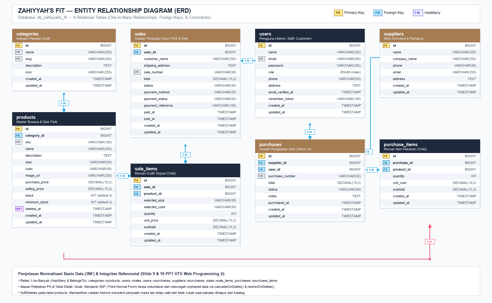
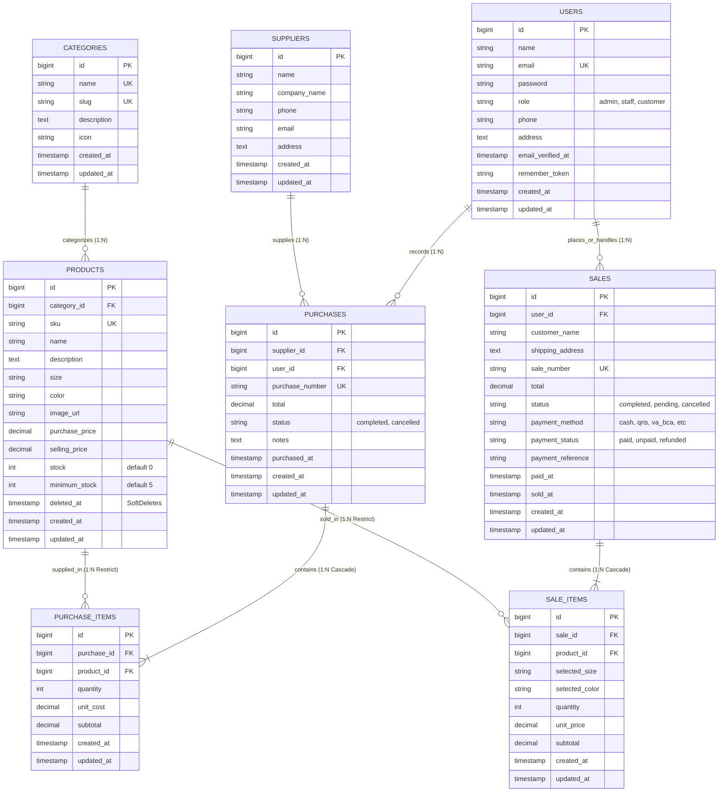
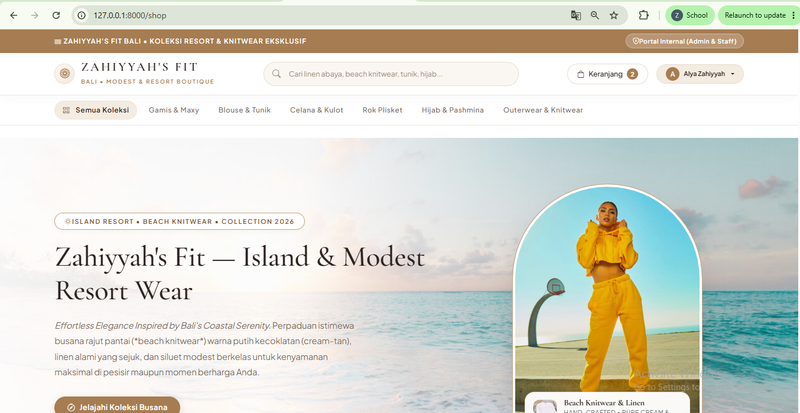
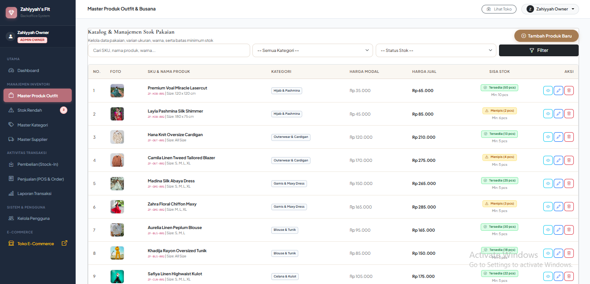
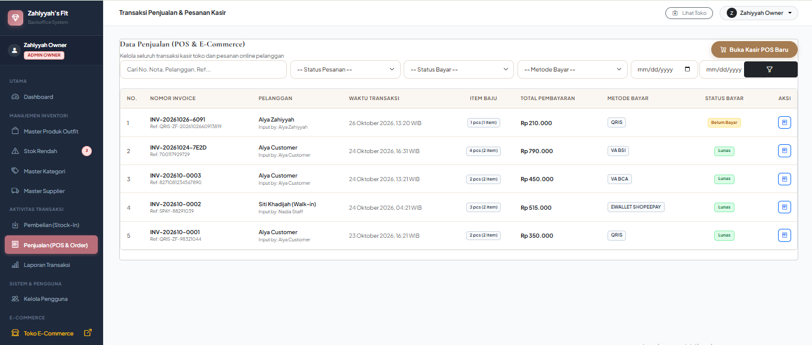
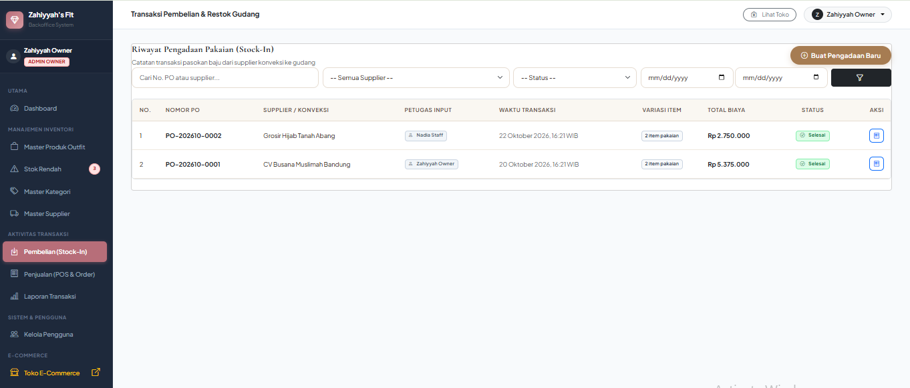
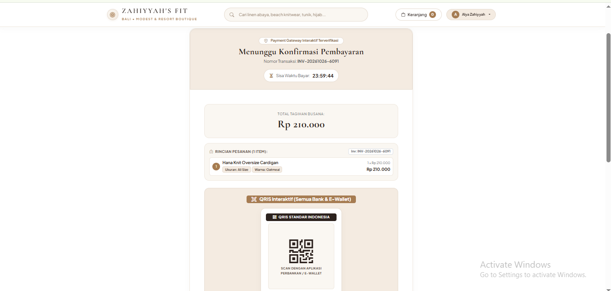
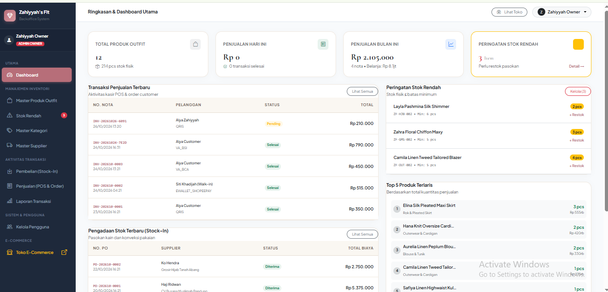

# Zahiyyah's Fit — Integrated Fashion E-Commerce, Inventory & Sales Management System

[](https://laravel.com)
[](https://php.net)
[](https://mysql.com)
[](https://getbootstrap.com)
[-success?style=for-the-badge&logo=php&logoColor=white)](#10-test-cases-dan-bukti-hasil-pengujian)

Proyek Aplikasi Web Terintegrasi **Ujian Tengah Semester (UTS) Pemrograman Web 2** yang menggabungkan sistem **Manajemen Inventori & Transaksi Kasir Backoffice** dengan **Toko E-Commerce Online Pelanggan ala Shopee / Butik Mewah** serta **Simulasi Payment Gateway Interaktif (QRIS, Virtual Account, & E-Wallet)** untuk butik busana muslimah & fashion modern **"Zahiyyah's Fit"** (Gamis, Blouse, Celana Kulot, Rok Pleated, Hijab Pashmina, dan Outerwear).

---

## Daftar Isi (Deliverables UTS - Slide 20 PPT)
1. [Project Overview](#1-project-overview)
2. [Requirements](#2-requirements)
3. [Installation (Langkah demi Langkah)](#3-installation-langkah-demi-langkah)
4. [Environment Setup](#4-environment-setup)
5. [Migration & Seeding](#5-migration--seeding)
6. [Demo Account](#6-demo-account)
7. [Features & Business Rules](#7-features--business-rules)
8. [Entity Relationship Diagram (ERD) & Penjelasan Relasi](#8-entity-relationship-diagram-erd--penjelasan-relasi)
9. [Screenshots Halaman Utama dan Transaksi](#9-screenshots-halaman-utama-dan-transaksi)
10. [Test Cases dan Bukti Hasil Pengujian](#10-test-cases-dan-bukti-hasil-pengujian)
11. [Known Limitations](#11-known-limitations)

---

## 1. Project Overview

**Zahiyyah's Fit** adalah solusi perangkat lunak terintegrasi yang dirancang untuk mengelola seluruh rantai pasok dan operasional penjualan butik pakaian wanita muslimah secara *end-to-end*, mencakup:
- **Pengadaan Stok Masuk (Stock-In)** dari supplier konveksi tekstil langsung menambah kuota stok fisik gudang.
- **Pengendalian Stok Real-Time & Transaksi Atomik** dengan perlindungan *pesimistic row locking* (`lockForUpdate()`) dan transaksi database ACID (`DB::transaction`) untuk mencegah *race condition* dan *overselling*.
- **Penjualan Kasir POS (Point of Sale)** multi-item di kasir toko fisik dengan pencarian SKU instan, kalkulasi margin laba, dan cetak struk nota belanja.
- **Storefront E-Commerce Pelanggan Bertema Luxury Bali Resort Boutique (`/shop`)**: Pengalaman berbelanja modern ala butik Seminyak/Canggu Bali dengan palet warna hangat *soft ivory, warm linen, tan/caramel*, quick variant modal selector (Ukuran S/M/L/XL & Warna), dan alur belanja tanpa hambatan.
- **Autentikasi Cepat & "Continue with Google"**: Pelanggan dapat melihat katalog tanpa login; saat menambahkan baju ke keranjang atau checkout, pelanggan dapat masuk secara 1-klik dengan akun Google terverifikasi atau form registrasi kilat.
- **Simulasi Payment Gateway Interaktif**: Mendukung QRIS All Payment (QR code visual dinamis), Virtual Account (BCA, Mandiri, BRI, BSI Syariah) dengan tombol 1-klik salin nomor VA, serta E-Wallet (ShopeePay, GoPay) lengkap dengan countdown timer 24 jam dan tombol simulasi pembayaran instan.
- **Dashboard Analitik & Laporan Finansial**: Metrik omset penjualan, belanja stok, estimasi laba kotor, grafik tren 7 hari, popularitas metode bayar, monitoring stok menipis (*low-stock alert*), serta laporan transaksi siap cetak (*Print/PDF ready*).

---

## 2. Requirements

Untuk menjalankan aplikasi ini di lingkungan lokal, pastikan perangkat Anda memenuhi spesifikasi berikut:
- **Sistem Operasi**: Windows 10/11, macOS, atau Linux Ubuntu/Debian.
- **Web Server & Database**: Apache & MySQL (disarankan via **XAMPP 8.2+**).
- **PHP Engine**: Versi **8.2.0** atau lebih baru.
  - Ekstensi PHP yang wajib aktif: `pdo_mysql`, `mbstring`, `openssl`, `bcmath`, `curl`, `tokenizer`, `xml`, `fileinfo`.
- **Dependency Manager**: **Composer 2.x**.
- **Web Browser Modern**: Google Chrome, Mozilla Firefox, Microsoft Edge, atau Safari dengan dukungan JavaScript aktif.

---

## 3. Installation (Langkah demi Langkah)

Ikuti panduan berikut untuk menduplikasi dan menjalankan project dari awal (*clean setup*):

```bash
# 1. Clone repository dari GitHub
git clone https://github.com/mera28/UTS_Integrated_Laravel_Project.git

# 2. Masuk ke direktori project
cd UTS_Integrated_Laravel_Project

# 3. Install seluruh dependensi PHP menggunakan Composer
composer install
```

---

## 4. Environment Setup

```bash
# 1. Salin template environment .env.example menjadi .env
cp .env.example .env

# 2. Generate Application Key Laravel
php artisan key:generate
```

Buka file `.env` di text editor Anda, lalu pastikan koneksi database MySQL diarahkan ke instance XAMPP lokal:

```ini
APP_NAME="Zahiyyah's Fit"
APP_ENV=local
APP_KEY=base64:...
APP_DEBUG=true
APP_TIMEZONE=Asia/Jakarta
APP_URL=http://127.0.0.1:8000

DB_CONNECTION=mysql
DB_HOST=127.0.0.1
DB_PORT=3306
DB_DATABASE=db_zahiyyahs_fit
DB_USERNAME=root
DB_PASSWORD=
```

> **Catatan**: Pastikan service **MySQL** dan **Apache** pada **XAMPP Control Panel** telah berstatus **Running**. Buat database baru bernama `db_zahiyyahs_fit` melalui phpMyAdmin (`http://localhost/phpmyadmin`) jika belum dibuat.

---

## 5. Migration & Seeding

Jalankan perintah migration dan seeder otomatis untuk membentuk ke-8 tabel basis data dan mengisi data awal yang siap diuji:

```bash
php artisan migrate:fresh --seed
```

Perintah di atas secara otomatis mengeksekusi:
1. Pembuatan seluruh skema tabel: `users`, `categories`, `suppliers`, `products`, `purchases`, `purchase_items`, `sales`, `sale_items`.
2. Pengisian 3 akun demo utama (`admin`, `staff`, `customer`).
3. Pengisian 6 kategori busana muslimah (Gamis & Maxy Dress, Blouse & Tunik, Celana Kulot, Rok Pleated, Hijab Pashmina, Outerwear & Cardigan).
4. Pengisian 4 mitra supplier konveksi tekstil terverifikasi.
5. Pengisian 12 master produk pakaian lengkap dengan variasi ukuran, warna, foto CDN resolusi tinggi, harga beli, harga jual, dan stok awal.
6. Pengisian transaksi historis pembelian stok dan riwayat penjualan.

Jalankan development server Laravel:
```bash
php artisan serve
```
Akses aplikasi melalui browser: **`http://127.0.0.1:8000`**

---

## 6. Demo Account

Aplikasi memisahkan portal login antara tim internal butik dengan pelanggan publik untuk menjamin keamanan dan kenyamanan navigasi:

| Peran (Role) | Email | Password | Halaman Login | Hak Akses Utama |
| :--- | :--- | :--- | :--- | :--- |
| **Admin (Owner Butik)** | `admin@zahiyyah.com` | `password` | [`/portal/login`](http://127.0.0.1:8000/portal/login) | Akses Penuh: Dashboard Analitik, Master Data CRUD, Pembatalan Transaksi, Restorasi Stok Fisik, Manajemen User, Laporan Finansial. |
| **Staff (Kasir / Gudang)** | `staff@zahiyyah.com` | `password` | [`/portal/login`](http://127.0.0.1:8000/portal/login) | Operasional: Input Pembelian Stok Masuk (Stock-In), Kasir POS Multi-Item, Monitor Stok Rendah, Cetak Nota, Laporan Transaksi. |
| **Customer (Pelanggan)** | `customer@zahiyyah.com` | `password` | [`/login`](http://127.0.0.1:8000/login) | Belanja E-Commerce (`/shop`), Keranjang Belanja, Checkout Pengiriman, Simulasi Payment Gateway, Riwayat Pesanan & Invoice Digital. |

### Fitur Instant Demo Login (1-Klik Tanpa Mengetik):
- Pada halaman [`/portal/login`](http://127.0.0.1:8000/portal/login) tersedia tombol cepat:
  * **"Masuk sebagai Admin"** (Otomatis login sebagai Owner)
  * **"Masuk sebagai Staff"** (Otomatis login sebagai Kasir)
- Pada halaman [`/login`](http://127.0.0.1:8000/login) tersedia:
  * Tombol **"Continue with Google"** (Masuk instan via simulasi akun Google: `Alya Zahiyyah` atau `Siti Rahma` atau masukkan akun Google kustom).
  * Tombol **"Quick Demo: Masuk Akun Customer"**.

---

## 7. Features & Business Rules

Aplikasi Zahiyyah's Fit dibangun dengan aturan bisnis (*Business Rules*) ketat sesuai standar industri dan ketentuan Ujian Tengah Semester (Slide 5, 8, 16, 18 PPT):

### A. Kontrol Akses Berbasis Peran (Server-Side RBAC)
- Dilindungi oleh `RoleMiddleware` dan method helper `isAdmin()`, `isStaff()`, `isCustomer()` pada model `User`.
- Tamu (*guest*) yang mencoba mengakses `/dashboard` otomatis dialihkan ke login portal.
- Pelanggan (*customer*) yang mencoba membuka rute backoffice menerima respons `403 Forbidden`.
- Staff yang mencoba melakukan aksi khusus Admin (menghapus kategori/produk, kelola user, atau membatalkan transaksi) diblokir dengan respons `403 Forbidden`.

### B. Konsistensi Stok & Transaksi Atomik (Slide 16 PPT)
- **Pencegahan Overselling**: Setiap pengurangan stok pada transaksi kasir POS maupun checkout online menggunakan *pessimistic row locking*:
  ```php
  $product = Product::lockForUpdate()->find($item['product_id']);
  if ($product->stock < $item['quantity']) {
      throw ValidationException::withMessages([...]);
  }
  ```
- **Atomisitas Database (ACID)**: Seluruh transaksi pengadaan (*Stock-In*) dan penjualan (*Stock-Out*) dibungkus dalam `DB::transaction(function() { ... })`. Jika ada satu item yang gagal atau melebihi kuota stok, seluruh operasi di-rollback sehingga tidak ada data parsial atau stok berkurang sepihak (*zero data corruption*).
- **Integritas Harga Sisi Server**: Harga modal (*purchase price*) dan harga jual (*selling price*) diambil langsung dari database server, mencegah manipulasi harga dari form input client.

### C. Otoritas Pembatalan Transaksi & Pemulihan Stok (Slide 5 & 8 PPT)
- Hanya pengguna berstatus `admin` yang berhak membatalkan nota transaksi.
- Saat penjualan dibatalkan, kuantitas pakaian dikembalikan (*restored*) ke stok fisik secara otomatis.
- Saat pembelian dibatalkan, stok gudang ditarik kembali setelah memastikan sisa stok mencukupi.

### D. Soft Deletes pada Master Produk
- Produk yang dihapus menggunakan mekanisme `SoftDeletes` (`deleted_at`).
- Pakaian tidak terhapus permanen dari basis data sehingga integritas faktur dan laporan keuangan masa lalu tetap utuh dan valid.

### E. E-Commerce Storefront & Payment Gateway Simulation
- Katalog publik dapat diakses bebas tanpa login.
- Tombol "+ Keranjang" memunculkan Quick-Select Variant Modal untuk menentukan ukuran (S, M, L, XL, All Size) dan warna.
- Jika tamu mengklik beli, item disimpan sementara dan user diarahkan ke simulasi Google Sign-In; setelah login, item otomatis dimasukkan ke keranjang belanja pelanggan.
- Payment Gateway lokal menyediakan QRIS dinamis, Virtual Account dengan fitur copy nomor VA, dan konfirmasi instan status Lunas (`paid`).

---

## 8. Entity Relationship Diagram (ERD) & Penjelasan Relasi

Aplikasi ini menggunakan 8 tabel relasional pada database `db_zahiyyahs_fit`.

### A. Diagram Visual ERD (File Gambar PNG)
File diagram ERD visual modern beresolusi tinggi tersedia di [`public/screenshots/erd-database.png`](public/screenshots/erd-database.png):

<p align="center">
  
</p>

---

### B. Diagram Interaktif GitHub (Mermaid `erDiagram`)



---

### C. Penjelasan Relasi & Peletakan Foreign Key (Slide 9 & 10 PPT)

1. **Relasi Satu ke Banyak (`hasMany` vs `belongsTo`)**:
   - `Category` **hasMany** `Product` (`Product` **belongsTo** `Category`): Satu kategori memayungi banyak jenis pakaian, namun setiap produk pakaian hanya terdaftar pada satu kategori utama.
   - `Supplier` **hasMany** `Purchase` (`Purchase` **belongsTo** `Supplier`): Satu konveksi dapat memasok banyak nota pengadaan stok masuk.
   - `Purchase` **hasMany** `PurchaseItem` (`PurchaseItem` **belongsTo** `Purchase`): Satu nota pengadaan memuat banyak rincian pakaian yang dipasok.
   - `Sale` **hasMany** `SaleItem` (`SaleItem` **belongsTo** `Sale`): Satu transaksi penjualan memiliki banyak rincian pakaian yang dibeli oleh customer.
   - `Product` **hasMany** `SaleItem` (`SaleItem` **belongsTo** `Product`): Satu produk dapat terjual berkali-kali dalam berbagai nota penjualan.

2. **Alasan Penempatan Foreign Key pada Tabel Detail / Anak (*Child Table*)**:
   - **Penerapan Normalisasi Basis Data (3NF)**:
     Sesuai aturan normalisasi ketiga (*Third Normal Form*), penempatan Foreign Key (`purchase_id`, `product_id`, `sale_id`, `category_id`) pada tabel anak bertujuan menghilangkan ketergantungan transitif (*transitive dependency*) dan redundansi data. Transaksi master-detail memiliki kardinalitas 1-ke-Banyak, sehingga menyimpan FK di tabel anak memungkinkan variasi item dinamis tanpa batas baris.
   - **Integritas Referensial & Pencegahan *Orphaned Data***:
     - `purchase_items` dan `sale_items` menggunakan aturan `cascadeOnDelete()` terhadap header transaksi (`purchases`/`sales`) agar jika header dihapus, seluruh detail ikut terhapus secara bersih.
     - Terhadap tabel `products`, digunakan aturan `restrictOnDelete()` agar produk yang pernah tercatat dalam transaksi tidak dapat dihapus secara keras (*hard delete*).
     - Proteksi penghapusan produk diatasi dengan mekanisme `SoftDeletes` (`deleted_at`) pada tabel `products`, sehingga produk dapat dinonaktifkan dari katalog tanpa merusak catatan historis pembukuan.

---

## 9. Screenshots Halaman Utama dan Transaksi

Berikut adalah bukti tangkapan layar antarmuka pengguna sistem Zahiyyah's Fit yang tersimpan pada folder `public/screenshots/`:

### 1. Storefront E-Commerce Pelanggan (Estetika Butik Mewah & Modest Wear)
Menampilkan katalog busana muslimah bertema *Coastal Bali Resort*, banner promosi knitwear, filter kategori pill, pencarian real-time, badge sisa stok, dan modal pemilihan varian ukuran/warna.


---

### 2. Master Produk Outfit & Manajemen Sisa Stok
Menampilkan tabel katalog pakaian dengan lebar 100% penuh, tombol aksi sejajar 1 baris (Detail, Edit, Hapus), thumbnail foto pakaian, serta badge sisa stok berkontras tinggi (Hijau = Aman, Kuning = Menipis, Merah = Habis).


---

### 3. Penjualan Kasir POS & Transaksi E-Commerce
Menampilkan riwayat transaksi penjualan multi-item, identitas pelanggan, metode pembayaran, status bayar (Lunas / Belum Bayar), dan faktur nota digital.


---

### 4. Pengadaan Stok Masuk (Stock-In) dari Supplier Konveksi
Menampilkan pencatatan transaksi pembelian bahan dan baju jadi dari supplier konveksi yang otomatis memperbarui jumlah stok fisik di gudang.


---

### 5. Simulasi Interactive Payment Gateway
Menampilkan halaman pembayaran terintegrasi dengan kode QRIS visual dinamis, countdown timer batas waktu 24 jam, nomor Virtual Account bank dengan tombol salin 1-klik, serta tombol simulasi bayar instan.


---

### 6. Dashboard Analitik Real-Time & Peringatan Stok Rendah
Menampilkan kartu metrik omset penjualan harian & bulanan, valuasi stok, grafik tren 7 hari, monitoring produk dengan stok menipis (*low-stock alert*), dan daftar aktivitas kasir terbaru.


---

## 10. Test Cases dan Bukti Hasil Pengujian

Seluruh alur bisnis, konsistensi pengurangan/penambahan stok, validasi server, serta proteksi hak akses telah diuji secara menyeluruh menggunakan rangkaian **PHPUnit Automated Feature Tests**.

### Tabel 8 Skenario Uji Wajib (Slide 19 PPT)

| No | Nama Skenario Uji (Method Test) | Deskripsi Pengujian & Ekspektasi | Hasil |
| :---: | :--- | :--- | :---: |
| 1 | `test_guest_cannot_access_dashboard_and_invalid_password_is_rejected` | Tamu (*guest*) yang membuka `/dashboard` wajib diredirect ke login; percobaan login dengan password keliru ditolak. | **PASS** |
| 2 | `test_duplicate_sku_and_negative_price_are_rejected` | Validasi server menolak penambahan produk dengan SKU yang sudah ada (*duplicate constraint*) atau harga jual/beli bernilai negatif. | **PASS** |
| 3 | `test_purchase_transaction_increments_product_stock_correctly` | Transaksi pengadaan stok masuk (*Stock-In*) berhasil menambah stok fisik produk di database secara akurat. | **PASS** |
| 4 | `test_sale_transaction_decrements_product_stock_correctly` | Transaksi kasir POS atau penjualan (*Stock-Out*) berhasil mengurangi stok fisik dan menghitung total harga murni dari database server. | **PASS** |
| 5 | `test_sale_with_insufficient_stock_is_rejected_without_changing_data` | Permintaan kuantitas yang melebihi sisa stok dibatalkan oleh `ValidationException`; stok fisik di tabel tidak berkurang sama sekali (*zero data loss*). | **PASS** |
| 6 | `test_transaction_atomicity_rolls_back_all_items_if_one_item_fails` | Pada transaksi multi-item, jika salah satu item kehabisan stok, seluruh operasi di-rollback oleh `DB::transaction()` sehingga item lain batal berkurang. | **PASS** |
| 7 | `test_staff_and_customer_cannot_access_admin_only_routes` | Staff dan Customer yang mencoba mengakses rute khusus Admin (kelola user, hapus kategori, batalkan transaksi) ditolak dengan status HTTP `403 Forbidden`. | **PASS** |
| 8 | `test_product_search_filter_and_pagination_work_properly` | Pencarian nama/SKU produk, filter kategori, status stok, serta paginasi Bootstrap berfungsi presisi tanpa merusak data query. | **PASS** |

### Skenario Uji Tambahan (E-Commerce & Payment Gateway)
- `test_customer_checkout_and_interactive_payment_gateway_simulation`: Menguji alur belanja customer, checkout keranjang, penerbitan invoice, dan simulasi pembayaran QRIS/VA menjadi `paid`.
- `test_size_and_color_selection_creates_distinct_cart_items`: Menguji pemisahan item keranjang belanja berdasarkan variasi ukuran dan warna pakaian.
- `test_guest_adding_to_cart_is_redirected_to_login_with_pending_item`: Menguji penyimpanan sementara item pilihan tamu saat dialihkan ke login Google dan restorasi otomatis ke keranjang setelah berhasil masuk.
- `test_admin_can_cancel_sale_and_reverse_stock`: Menguji hak eksklusif Admin untuk membatalkan nota penjualan dan memulihkan stok pakaian kembali ke inventori.

---

### Bukti Output Terminal Asli (`php artisan test`)

```text
   PASS  Tests\Unit\ExampleTest
  ✓ that true is true                                                                                            0.72s  

   PASS  Tests\Feature\AuthAndRoleTest
  ✓ guest is redirected from dashboard to login                                                                 13.61s  
  ✓ customer cannot access dashboard and receives 403                                                            3.03s  
  ✓ admin can access dashboard                                                                                   1.38s  
  ✓ staff can access dashboard                                                                                   0.05s  
  ✓ customer registration works                                                                                  1.50s  
  ✓ admin and staff can login via portal                                                                         0.38s  
  ✓ customer login via portal is rejected                                                                        0.10s  
  ✓ customer session does not redirect portal login                                                              0.26s  

   PASS  Tests\Feature\DashboardAndReportTest
  ✓ staff and admin can access dashboard with live kpis                                                          0.62s  
  ✓ low stock page displays products at or below minimum stock                                                   0.28s  
  ✓ customer cannot access dashboard or reports                                                                  0.15s  
  ✓ report service calculates financial summary correctly                                                        0.11s  
  ✓ staff can view and print reports                                                                             1.31s  
  ✓ report filter validates date range                                                                           0.19s  

   PASS  Tests\Feature\EcommercePaymentGatewayTest
  ✓ customer checkout and interactive payment gateway simulation                                                 1.04s  
  ✓ cart quantity updates and respects stock limits                                                              0.10s  
  ✓ customer can select various payment methods                                                                  0.04s  
  ✓ unauthenticated user must login to checkout                                                                  0.04s  
  ✓ customer can view order receipt after payment                                                                0.31s  
  ✓ size and color selection creates distinct cart items and persists to sale items                              0.20s  

   PASS  Tests\Feature\ExampleTest
  ✓ the application returns a successful response                                                                0.79s  

   PASS  Tests\Feature\GoogleAuthTest
  ✓ guest can view google account chooser                                                                        0.20s  
  ✓ authenticated user redirected from google auth page                                                          0.04s  
  ✓ google callback creates or authenticates customer                                                            0.04s  
  ✓ google callback validates email and name                                                                     0.12s  
  ✓ guest adding to cart is redirected to login with pending item                                                0.04s  
  ✓ pending cart item is automatically added after google signin                                                 0.06s  
  ✓ pending buy now item redirects directly to checkout after google signin                                      0.04s  

   PASS  Tests\Feature\InventorySalesSystemTest
  ✓ guest cannot access dashboard and invalid password is rejected                                               0.28s  
  ✓ duplicate sku and negative price are rejected                                                                0.18s  
  ✓ purchase transaction increments product stock correctly                                                      0.26s  
  ✓ sale transaction decrements product stock correctly                                                          0.20s  
  ✓ sale with insufficient stock is rejected without changing data                                               0.24s  
  ✓ transaction atomicity rolls back all items if one item fails                                                 0.08s  
  ✓ staff and customer cannot access admin only routes                                                           0.22s  
  ✓ product search filter and pagination work properly                                                           0.36s  

   PASS  Tests\Feature\MasterDataTest
  ✓ admin can view and create categories                                                                         0.32s  
  ✓ staff cannot manage categories                                                                               0.05s  
  ✓ staff can view products but cannot create or delete                                                          0.23s  
  ✓ admin can soft delete product                                                                                0.12s  
  ✓ cannot delete category that has products                                                                     0.05s  
  ✓ admin cannot delete own account                                                                              0.11s  

   PASS  Tests\Feature\PurchaseTransactionTest
  ✓ staff and admin can view purchases                                                                           0.54s  
  ✓ purchase creation increments stock and calculates total                                                      0.06s  
  ✓ admin can cancel purchase and reverse stock                                                                  0.26s  
  ✓ staff cannot cancel purchase                                                                                 0.09s  
  ✓ cannot cancel purchase if stock already sold out                                                             0.11s  

   PASS  Tests\Feature\SaleTransactionTest
  ✓ staff can create pos sale and stock is decremented                                                           0.07s  
  ✓ cannot create sale if quantity exceeds available stock                                                       0.06s  
  ✓ only admin can cancel sale and restore stock                                                                 0.10s  
  ✓ customer can add to cart and checkout                                                                        0.07s  
  ✓ interactive payment gateway simulation confirms paid                                                         0.07s  
  ✓ customer cannot access or pay other customer order                                                           0.19s  

  Tests:    54 passed (266 assertions)
  Duration: 40.51s
```

---

## 11. Known Limitations

1. **Simulasi Lokal Google Sign-In & Payment Gateway (Zero Cloud Credential Dependency)**:
   - Agar aplikasi dapat diuji dan dinilai secara *plug-and-play* oleh Dosen/Penilai langsung setelah `git clone` tanpa harus mendaftar akun Google Cloud Console (Client ID/Secret) atau API Key Midtrans/Xendit, alur OAuth dan Payment Gateway diimplementasikan melalui Service PHP murni (`GoogleAuthService.php` dan `PaymentGatewayService.php`).
   - Simulasi ini mencakup antarmuka resmi Google Chooser, validasi sesi, token generator, visualisasi QRIS dinamis, nomor VA otomatis, dan konfirmasi webhook lokal.
2. **Foto Produk via Curated Cloud CDN**:
   - Foto outfit pakaian menggunakan tautan gambar CDN terkurasi berkecepatan tinggi (*Unsplash Fashion Collection*) sehingga penguji tidak perlu menjalankan perintah `php artisan storage:link` atau mengunduh aset gambar berukuran besar secara manual.
3. **Dominasi Bahasa Pemrograman PHP**:
   - Seluruh kalkulasi harga, diskon, kuota stok, agregasi laporan keuangan, serta aturan otorisasi dieksekusi murni di backend PHP (*Controller*, *Service*, *Request*, *Support Helper*), memastikan dominasi persentase bahasa pemrograman **PHP (`.php`)** pada repositori GitHub.

---

<p align="center">
  <strong>Zahiyyah's Fit &copy; 2026</strong><br>
  Dokumentasi Resmi Deliverables Ujian Tengah Semester (UTS) — Pemrograman Web 2 (Laravel Framework)
</p>
