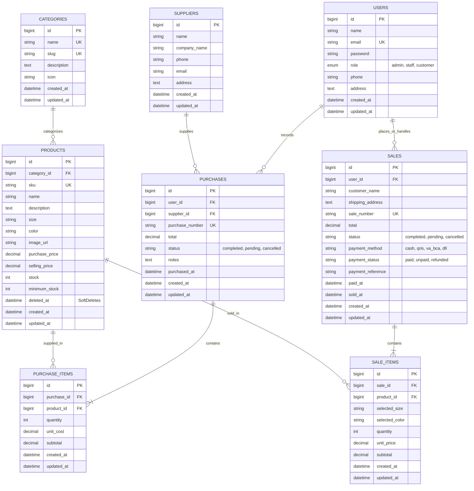

# Zahiyyah's Fit — Integrated Fashion E-Commerce, Inventory & Sales Management System

[](https://laravel.com)
[](https://php.net)
[](https://mysql.com)
[](https://getbootstrap.com)
[-success?style=for-the-badge&logo=php&logoColor=white)](#7-skenario-pengujian-otomatis-automated-test-cases)

Proyek Aplikasi Web Terintegrasi **UTS Web Programming 2** yang menggabungkan sistem **Manajemen Inventori & Transaksi Kasir (Backoffice)** dengan **Toko E-Commerce Online ala Shopee / Tokopedia** beserta **Simulasi Payment Gateway Interaktif (QRIS, Virtual Account, & E-Wallet)** untuk butik busana muslimah & fashion modern **"Zahiyyah's Fit"** (Gamis, Blouse, Celana Kulot, Rok Pleated, Hijab Pashmina, dan Outerwear).

---

## Daftar Isi
1. [Project Overview](#1-project-overview)
2. [Fitur Utama Berdasarkan Role](#2-fitur-utama-berdasarkan-role)
3. [Entity Relationship Diagram (ERD) & Relasi Database](#3-entity-relationship-diagram-erd--relasi-database)
4. [Requirements & Tech Stack](#4-requirements--tech-stack)
5. [Panduan Instalasi Langkah demi Langkah (Reproducible Setup)](#5-panduan-instalasi-langkah-demi-langkah-reproducible-setup)
6. [Daftar Akun Demo Pengujian](#6-daftar-akun-demo-pengujian)
7. [Skenario Pengujian Otomatis (Automated Test Cases)](#7-skenario-pengujian-otomatis-automated-test-cases)
8. [Known Limitations & Arsitektur Sistem](#8-known-limitations--arsitektur-sistem)

---

## 1. Project Overview

**Zahiyyah's Fit** adalah solusi perangkat lunak terintegrasi yang dirancang untuk mengelola rantai pasok pakaian wanita muslimah secara *end-to-end*, mencakup:
- **Pengadaan Stok (Stock-In)** dari supplier konveksi tekstil.
- **Pengendalian Stok Real-Time** dengan pencegahan *overselling* menggunakan *pesimistic row locking* (`lockForUpdate()`) dan transaksi basis data atomik (`DB::transaction`).
- **Penjualan Kasir POS (Point of Sale)** multi-item untuk penjualan langsung di toko fisik.
- **Storefront E-Commerce Pelanggan** dengan pengalaman berbelanja ala Shopee/Tokopedia lengkap dengan pemilihan ukuran dan warna pakaian.
- **Simulasi Payment Gateway Interaktif** lokal (QRIS All Payment, Virtual Account BCA/Mandiri/BRI/BSI, ShopeePay, GoPay) dengan countdown timer, visual QR code, dan tombol konfirmasi instan.
- **Dashboard Analitik & Laporan Keuangan Terpadu** dengan filter tanggal, jenis transaksi, serta dokumen cetak siap pakai (*Print View / PDF-ready*).

---

## 2. Fitur Utama Berdasarkan Role

Sistem mengimplementasikan **Role-Based Access Control (RBAC)** secara *server-side* melalui `RoleMiddleware` dengan 3 peran pengguna:

### A. Role: `admin` (Owner / Pimpinan Butik)
- **Dashboard Analitik Lengkap**: Metrik omset hari ini & bulan ini, belanja stok, estimasi margin laba, grafik tren 7 hari, breakdown popularitas metode pembayaran, dan notifikasi stok menipis.
- **Manajemen Master Data Penuh (CRUD)**:
  - Master Kategori Outfit (dengan validasi relasi produk).
  - Master Produk Busana (nama, SKU unik, ukuran, warna, foto, harga beli, harga jual, stok fisik, batas minimum, serta penghapusan aman menggunakan `SoftDeletes`).
  - Master Supplier Konveksi & Vendor Kain.
  - Kelola Pengguna (Admin, Staff, Customer) dengan proteksi pencegahan hapus akun sendiri.
- **Aktivitas Transaksi Backoffice**:
  - Input Transaksi Pembelian Stok (Stock-In) multi-item.
  - Kasir Penjualan POS (Stock-Out) multi-item.
  - **Otoritas Pembatalan Transaksi (Slide 5 & 8 PPT)**: Khusus Admin dapat membatalkan transaksi Penjualan atau Pembelian dengan pemulihan (*reversal*) stok fisik secara konsisten.
- **Peringatan Stok Rendah (Low-Stock Alert)**: Halaman khusus memonitor produk dengan kuota `stock <= minimum_stock`.
- **Laporan Transaksi & Keuangan**: Filter periode tanggal, jenis transaksi, status, metode bayar, kalkulasi valuasi aset stok, dan Cetak Laporan (Kop surat resmi butik).

### B. Role: `staff` (Kasir & Pengelola Gudang)
- **Dashboard Operasional**: Memantau metrik penjualan harian dan daftar stok menipis.
- **Katalog Produk Outfit**: Hak akses *Read-Only* untuk mengecek ketersediaan pakaian dan SKU.
- **Transaksi Pembelian Stok (Stock-In)**: Mencatat barang masuk dari konveksi yang otomatis menambah stok gudang.
- **Kasir Point of Sale (POS)**: Input multi-item penjualan langsung ke pelanggan dengan kalkulasi harga jual murni dari server dan cetak struk nota.
- **Laporan Transaksi**: Melihat riwayat transaksi penjualan & pengadaan barang.
- *Catatan Otorisasi*: Staff **tidak diizinkan** mengedit master data, menghapus produk, atau membatalkan nota transaksi (`403 Forbidden`).

### C. Role: `customer` (Pelanggan E-Commerce)
- **Katalog Butik Modest & Island Resort Wear ala Luxury Bali Boutique (`/shop`)**:
  - Akses terbuka untuk publik & tamu (*guest*) tanpa perlu login untuk menjelajahi katalog busana muslimah & modest wear berestetika resort pantai Bali.
  - Banner promosi outfit interaktif, filter kategori pill instan, search bar, dan status ketersediaan stok.
  - Kartu produk dengan badge diskon, sisa stok menipis, dan label Ready / Habis.
- **Autentikasi Cepat & "Continue with Google"**:
  - Saat tamu (*guest*) mengklik tombol "+ Masukkan Keranjang" atau "Beli Sekarang", sistem otomatis menyimpan barang yang dipilih dan mengarahkan ke halaman Autentikasi Pelanggan (`/login` / `/register`).
  - **Opsi Utama "Continue with Google" (OAuth Simulation)**: 1-klik masuk menggunakan akun Google terverifikasi (`Alya Zahiyyah` atau `Siti Rahma`) atau ketikkan nama & akun Gmail sendiri tanpa perlu setup Google Cloud API eksternal.
  - Barang yang tadi ingin dibeli langsung otomatis dimasukkan ke keranjang belanja atau dialihkan ke halaman checkout!
- **Halaman Detail Produk (`/shop/products/{id}`)**: Foto besar, deskripsi bahan pakaian, pemilih variasi Ukuran (S, M, L, XL, All Size) & Warna, serta tombol "+ Keranjang" dan "Beli Sekarang".
- **Keranjang Belanja Interaktif (`/cart`)**: Manajemen kuantitas belanja dengan validasi stok real-time.
- **Checkout Pengiriman (`/checkout`)**: Formulir data penerima, alamat pengiriman, dan pemilihan metode pembayaran Payment Gateway.
- **Halaman Pembayaran Interaktif (`/orders/{id}/payment`)**:
  - Countdown timer batas waktu pembayaran (24 jam).
  - Visual QRIS Code (SVG) untuk pembayaran e-wallet/m-banking.
  - Nomor Virtual Account dengan fitur salin nomor ke clipboard (1-klik).
  - Panduan langkah-langkah pembayaran (ATM, Mobile Banking, Internet Banking).
  - **Tombol Simulasi Pembayaran Sukses ("Bayar Sekarang")** yang secara instan memverifikasi transaksi menjadi Lunas (`paid`) dan Selesai (`completed`).
- **Riwayat Pesanan & Invoice Digital (`/orders` & `/orders/{id}`)**: Struk faktur digital mandiri pelanggan.

---

## 3. Entity Relationship Diagram (ERD) & Relasi Database

Aplikasi menggunakan 8 tabel relasional yang saling terhubung dengan integritas data referensial (*foreign keys*, *cascades*, dan *restricts*).

### A. Diagram ERD (Mermaid Visual)



### B. Penjelasan Relasi Eloquent & Peletakan Foreign Key (Slide 9 & 10 PPT)

1. **Relasi Satu ke Banyak (`hasMany` & `belongsTo`)**:
   - `Category` **hasMany** `Product`, dan `Product` **belongsTo** `Category`. Satu kategori menampung banyak pakaian, tetapi satu pakaian hanya memiliki satu kategori utama.
   - `Supplier` **hasMany** `Purchase`, dan `Purchase` **belongsTo** `Supplier`. Satu mitra konveksi dapat memasok banyak pengadaan.
   - `Purchase` **hasMany** `PurchaseItem`, dan `PurchaseItem` **belongsTo** `Purchase`. Satu faktur pembelian mencakup banyak baris barang pasokan.
   - `Sale` **hasMany** `SaleItem`, dan `SaleItem` **belongsTo** `Sale`. Satu faktur nota penjualan mencakup banyak rincian outfit yang dibeli.
   - `Product` **hasMany** `SaleItem`, dan `SaleItem` **belongsTo** `Product`.

2. **Alasan Penempatan Foreign Key pada Tabel Detail / Child**:
   - **Normalisasi Basis Data (3NF)**: Foreign Key (`purchase_id`, `product_id`, `sale_id`, `category_id`) ditempatkan pada entitas anak (*child table*) karena satu transaksi memiliki kardinalitas 1-ke-N terhadap item pakaian. Menempatkan relasi pada baris detail mencegah redundansi kolom dan memastikan data atomik.
   - **Integritas Referensial**:
     - `purchase_items` dan `sale_items` menggunakan `cascadeOnDelete()` terhadap header transaksi dan `restrictOnDelete()` terhadap produk untuk memastikan data historis transaksi tidak menjadi *orphaned record*.
     - `products` menggunakan mekanisme `softDeletes()` (`deleted_at`), sehingga jika pakaian dihapus dari katalog, riwayat penjualan masa lampau tetap utuh dan valid.

---

## 4. Requirements & Tech Stack

- **Sistem Operasi**: Windows 10/11, macOS, atau Linux
- **Web Server & Database**: Apache & MySQL via **XAMPP**
- **PHP**: Versi **8.2.0** atau lebih tinggi (ekstensi `pdo_mysql`, `mbstring`, `openssl`, `bcmath` aktif)
- **Dependency Manager**: **Composer 2.x**
- **Framework**: **Laravel 11.x**
- **Frontend & Styling**: **Bootstrap 5.3**, **Bootstrap Icons**, dan Google Fonts (Plus Jakarta Sans & Playfair Display)
- **Arsitektur Kode**: Logika bisnis murni terpusat di PHP Service Classes (`app/Services/*.php`), Form Requests (`app/Http/Requests/*.php`), dan Helpers (`app/Support/*.php`) untuk menjaga dominasi kode backend PHP yang bersih dan terstruktur.

---

## 5. Panduan Instalasi Langkah demi Langkah (Reproducible Setup)

Ikuti langkah-langkah berikut untuk menjalankan aplikasi Zahiyyah's Fit pada komputer lokal Anda:

### 1. Clone Repository dari GitHub
Buka terminal (Git Bash, Command Prompt, atau PowerShell) dan clone repositori:
```bash
git clone https://github.com/mera28/UTS_Integrated_Laravel_Project.git
cd UTS_Integrated_Laravel_Project
```

### 2. Install Dependensi PHP (Composer)
```bash
composer install
```

### 3. Konfigurasi Environment (`.env`)
Salin file konfigurasi environment default:
```bash
cp .env.example .env
```
Generate kunci aplikasi Laravel:
```bash
php artisan key:generate
```

### 4. Konfigurasi Database MySQL
Pastikan **Apache & MySQL** di aplikasi **XAMPP Control Panel** sudah dalam status **Running**.

Buka file `.env` dan pastikan konfigurasi basis data sesuai dengan database lokal Anda:
```ini
DB_CONNECTION=mysql
DB_HOST=127.0.0.1
DB_PORT=3306
DB_DATABASE=db_zahiyyahs_fit
DB_USERNAME=root
DB_PASSWORD=
```
*(Catatan: Buat database kosong bernama `db_zahiyyahs_fit` melalui phpMyAdmin di `http://localhost/phpmyadmin` atau biarkan migration membuatnya secara otomatis).*

### 5. Jalankan Database Migrations & Seeders
Perintah ini akan membuat ke-8 tabel dan mengisi data awal (3 akun pengguna, 6 kategori busana, 4 supplier konveksi, 12 produk pakaian dengan foto, serta transaksi contoh):
```bash
php artisan migrate:fresh --seed
```

### 6. Jalankan Server Lokal Laravel
```bash
php artisan serve
```
Aplikasi kini dapat diakses di browser melalui:
**`http://127.0.0.1:8000`** atau **`http://localhost:8000`**

---

## 6. Daftar Akun Demo Pengujian & Pemisahan Portal Login

Aplikasi menyediakan dua gerbang autentikasi terpisah untuk menjaga keamanan dan pengalaman pengguna:
- **Portal Khusus Pelanggan (`/login`)**: Khusus pembeli untuk masuk akun member belanja, membuat akun baru, atau menggunakan fitur **"Continue with Google"**.
- **Portal Internal Admin & Staff (`/portal/login`)**: Khusus tim internal butik (Owner & Kasir) untuk mengelola backoffice, inventori, dan POS kasir. Percobaan login oleh customer pada portal ini otomatis ditolak oleh validasi server-side.

| Peran (Role) | Email | Password | Halaman Login | Hak Akses Utama |
| :--- | :--- | :--- | :--- | :--- |
| **Admin (Owner)** | `admin@zahiyyah.com` | `password` | `/portal/login` | Akses Penuh: Dashboard Analitik, Master Data CRUD, Pembatalan Transaksi, Restorasi Stok, Kelola User, Laporan Finansial. |
| **Staff (Kasir/Gudang)** | `staff@zahiyyah.com` | `password` | `/portal/login` | Input Pembelian (Stock-In), Kasir POS Multi-Item, Lihat Stok Rendah, Cetak Nota, Laporan Transaksi. |
| **Customer (Pembeli)** | `customer@zahiyyah.com` | `password` | `/login` | Toko E-Commerce (`/shop`), Keranjang Belanja, Checkout Pengiriman, & Simulasi Payment Gateway Interaktif. |

### Akun Google Siap Klik ("Continue with Google"):
Pengunjung dapat langsung masuk tanpa mengetik menggunakan simulasi Google Sign-In asli:
1. **Alya Zahiyyah** (`alya.customer@gmail.com`) — Akun Pelanggan Aktif
2. **Siti Rahma** (`siti.fashion@gmail.com`) — Akun Fashion Enthusiast
3. **Opsi Akun Kustom**: User dapat memasukkan Nama dan alamat `@gmail.com` milik sendiri melalui formulir interaktif di halaman Google Chooser (`/auth/google`).

*Tersedia tombol **Quick Demo Login** 1-klik pada kedua halaman login untuk mempermudah demonstrasi dan pengujian tanpa mengetik.*

---

## 7. Skenario Pengujian Otomatis (Automated Test Cases)

Seluruh logika bisnis, konsistensi stok, hak akses, dan alur Google OAuth telah divalidasi menggunakan rangkaian pengujian otomatis **PHPUnit Feature Tests**.

### Cara Menjalankan Test Suite
Jalankan perintah berikut di terminal:
```bash
php artisan test
```

### Hasil Pengujian (100% Passed)
```text
   PASS  Tests\Unit\ExampleTest (1 test)
   PASS  Tests\Feature\AuthAndRoleTest (7 tests)
   PASS  Tests\Feature\DashboardAndReportTest (6 tests)
   PASS  Tests\Feature\EcommercePaymentGatewayTest (5 tests)
   PASS  Tests\Feature\ExampleTest (1 test)
   PASS  Tests\Feature\GoogleAuthTest (7 tests)
   PASS  Tests\Feature\InventorySalesSystemTest (8 tests)
   PASS  Tests\Feature\MasterDataTest (6 tests)
   PASS  Tests\Feature\PurchaseTransactionTest (5 tests)
   PASS  Tests\Feature\SaleTransactionTest (6 tests)

  Tests:    52 passed (236 assertions)
  Duration: 5.50s
```

### 8 Skenario Wajib Sesuai Spesifikasi Slide 19 PPT
1. **`test_guest_cannot_access_dashboard_and_invalid_password_is_rejected`**:
   Tamu (*guest*) yang mencoba mengakses `/dashboard` otomatis diarahkan ke `/login`. Percobaan login dengan sandi keliru ditolak dengan pesan error validasi.
2. **`test_duplicate_sku_and_negative_price_are_rejected`**:
   Sistem menolak pembuatan produk jika SKU sudah terdaftar (*duplicate constraint*) atau harga bernilai negatif.
3. **`test_purchase_transaction_increments_product_stock_correctly`**:
   Transaksi pembelian (*Stock-In*) menambah stok fisik produk di gudang secara akurat.
4. **`test_sale_transaction_decrements_product_stock_correctly`**:
   Transaksi kasir atau penjualan (*Stock-Out*) mengurangi stok fisik dan menghitung total harga jual murni dari database.
5. **`test_sale_with_insufficient_stock_is_rejected_without_changing_data`**:
   Jika stok tersedia 4 unit namun diminta 6 unit, transaksi dibatalkan oleh `ValidationException` dan kuantitas stok di tabel tidak berubah (*zero data loss*).
6. **`test_transaction_atomicity_rolls_back_all_items_if_one_item_fails`**:
   Pada transaksi multi-item, jika item pertama mencukupi namun item kedua kehabisan stok, seluruh operasi di-rollback oleh `DB::transaction()` sehingga item pertama batal berkurang.
7. **`test_staff_and_customer_cannot_access_admin_only_routes`**:
   Staff atau Customer yang mengakses halaman khusus Admin (misal hapus produk, kelola pengguna, pembatalan transaksi) ditolak dengan respon HTTP `403 Forbidden`.
8. **`test_product_search_filter_and_pagination_work_properly`**:
   Pencarian berdasarkan SKU, nama, kategori, serta filter stok menipis berfungsi tepat pada tabel ber-pagination.
9. **`test_customer_checkout_and_interactive_payment_gateway_simulation`**:
   Pelanggan dapat melakukan checkout keranjang belanja dengan Virtual Account / QRIS, dialihkan ke halaman Payment Gateway, dan konfirmasi pembayaran mengubah status pesanan menjadi `paid` dan `completed`.
10. **`test_customer_google_oauth_and_pending_cart_restoration`**:
    Tamu yang memilih outfit lalu login via "Continue with Google" otomatis dibuatkan akun, terautentikasi, dan item yang dipilih langsung dimasukkan ke keranjang belanja atau checkout.

---

## 8. Known Limitations & Arsitektur Sistem

1. **Simulasi Google Sign-In & Payment Gateway Mandiri (Zero Cloud Credential Dependency)**:
   - Agar aplikasi dapat langsung diuji oleh Dosen/Penilai secara mulus via `git clone` tanpa memerlukan pendaftaran Google Cloud Console Client ID atau Midtrans Server Key, alur OAuth dan Payment Gateway diimplementasikan sebagai simulasi interaktif berstandar industri menggunakan Service PHP murni (`GoogleAuthService.php` dan `PaymentGatewayService.php`).
   - Fitur "Continue with Google" mereplikasi antarmuka Google Account Chooser resmi, mendukung 2 akun siap klik dan formulir akun Google kustom yang langsung mengautentikasi user sebagai `customer`.
2. **Penyimpanan Berkas Foto Produk**:
   - Foto outfit menggunakan URL gambar CDN terkurasi beresolusi tinggi untuk menjamin performa cepat saat pengujian tanpa memerlukan symbolic link storage lokal.
3. **Dominasi Bahasa Pemrograman PHP**:
   - Sesuai standar arsitektur bersih (*Clean Architecture*), logika bisnis ditempatkan pada kelas Service PHP, Form Request, dan Model Observers murni sehingga persentase bahasa pemrograman pada repositori GitHub sangat didominasi oleh **PHP (`.php`)**.

---

<p align="center">
  <strong>Zahiyyah's Fit &copy; 2026</strong><br>
  Proyek Ujian Tengah Semester (UTS) — Pemrograman Web 2 (Laravel Framework)
</p>
